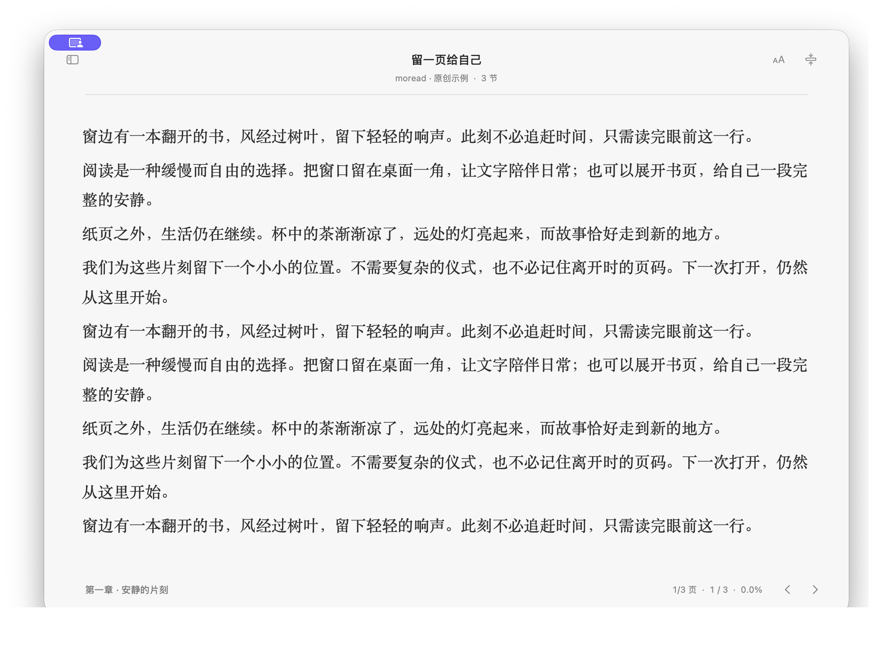
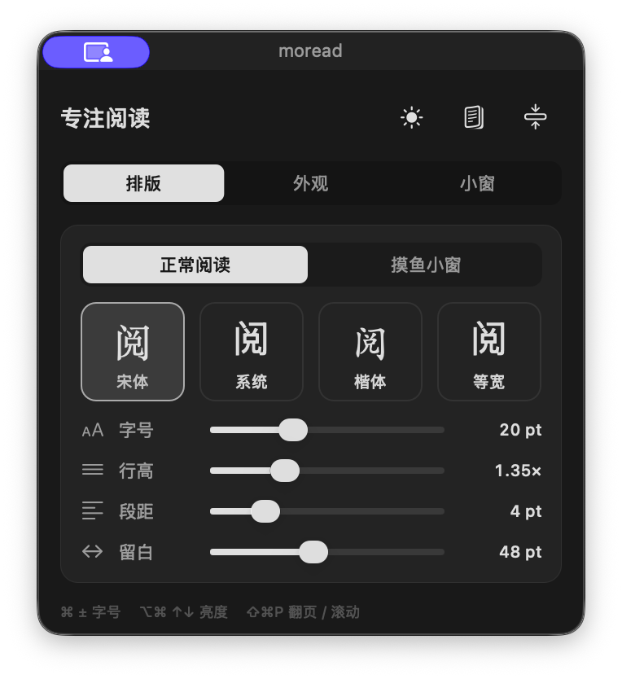

<div align="center">

# moread

**A quiet place for your books. Anywhere on your Mac.**

A native, local-first EPUB reader with a full reading view and a tiny, transparent window that keeps only the words you need.

[](#requirements)
[](#build-from-source)
[](LICENSE)
[](https://github.com/Mudsuen/moread/actions/workflows/test.yml)

[Download for macOS · Apple Silicon](https://github.com/Mudsuen/moread/releases/latest) · [All releases](https://github.com/Mudsuen/moread/releases)

</div>

## Reading, without the extra chrome

moread is built for people who switch between focused reading and keeping a few lines beside their work. Open a local EPUB, pick a chapter, and read in a conventional window—or shrink it into a borderless, always-on-top reader.

The interface is native Swift and AppKit, with a restrained grayscale palette. Books and reading positions stay on your Mac. There are no accounts, subscriptions, analytics, or third-party runtime dependencies.

## Download and install

**[Download the latest DMG](https://github.com/Mudsuen/moread/releases/latest/download/moread-1.3.4-macOS-arm64.dmg)** · [ZIP alternative](https://github.com/Mudsuen/moread/releases/latest/download/moread-1.3.4-macOS-arm64.zip)

For Apple Silicon Macs running macOS 14 or later. Open the DMG, drag **moread** into **Applications**, eject the disk image, then open the app. With the ZIP, extract it and move `moread.app` into Applications. Quit an existing copy before replacing it; your local library is kept separately.

**Signing:** this build is signed with an Apple Development certificate and is **not notarized**. Gatekeeper may block the first launch. After attempting to open it, review the warning in **System Settings → Privacy & Security** and use **Open Anyway** only if you trust this download. Managed Macs may prohibit this. Do not disable Gatekeeper. SHA-256 checksums are included with the release; Intel builds are not provided.

## Screenshots

Real application captures using original demonstration text and an isolated sample library. The gradient behind the compact reader is a separate demonstration background, not an app backplate.

### Focused reading



### Transparent compact window


### Typography settings



Settings follow the system appearance and stay at full brightness. Reading theme, brightness, and transparency affect the reading windows only.

## Features

| | What you can do |
| --- | --- |
| **Two reading windows** | Switch between a library-backed reader and a compact, draggable, resizable window. |
| **Text-only transparency** | Adjust background and text opacity separately. Remove the background completely while keeping the words visible. |
| **Adaptive text color** | Optionally choose dark or light text from the actual background beneath each visible glyph, including mixed backgrounds. |
| **Pages or continuous scrolling** | Use contiguous text pages without repeated content, or scroll within a chapter. |
| **Independent typography** | Keep separate font size, typeface, line height, and paragraph spacing for each window mode. Preview Songti, system, Kaiti, and monospaced fonts. |
| **Light, dark, or system appearance** | Set the theme independently of app-local brightness. |
| **Unobtrusive controls** | Hover to reveal small, borderless contents, typography, and pin controls just above the first line. Move away to hide them. |
| **Quick concealment** | Double-click the small window to visually hide or restore it. Hold both horizontal arrow keys to toggle window visibility. |
| **Local reading history** | Automatically save the selected book, chapter, source-text position, preferences, and window geometry. |
| **Searchable contents** | Browse EPUB chapter titles without leaving the compact reader. |

Resizing retains the current page's first source character. Visual concealment preserves your opacity settings and reading position. Hidden windows and visually concealed content reject paging, scrolling, and chapter-navigation commands; queued arrow events are cancelled when hiding. Opening moread from the Dock or menu bar brings the reader forward with brief location feedback.

## Requirements

- macOS 14 or later.
- Xcode 16 or later, or a compatible Swift 6 toolchain, for building from source.
- An unencrypted EPUB file or an unpacked EPUB directory.
- Optional macOS screen-recording permission for adaptive text contrast.

The current interface is primarily in Chinese. Apple Silicon has been tested; Intel compatibility has not been verified. Prebuilt Apple Silicon DMG and ZIP downloads are available in Releases. They are development-signed, not notarized.

## Build from source

```sh
git clone https://github.com/Mudsuen/moread.git
cd moread
swift build
swift run MudsReader
```

The package and executable retain the original internal name `MudsReader`; the application is named **moread**.

To create a signed application bundle:

```sh
./scripts/package.sh
open build/moread.app
```

Packaging requires a valid Apple Development signing identity in your Keychain. The script selects an available identity; set `CODE_SIGN_IDENTITY` explicitly if you have more than one. No certificate or private key is included in this repository.

Use the same identity for subsequent builds if you enable screen capture. Ad-hoc signatures bind permissions to a changing code hash and are intentionally rejected by the packaging script. A locally signed development build is not the same as a notarized distribution build.

## Get started

1. Choose **File → Import EPUB** (`文件 → 导入 EPUB`), or use the Apple Books import entry to locate an accessible local book.
2. Select a chapter and start reading. Paged mode is the default.
3. Press **⌘⇧M** for the small window. Drag the text area to move it and drag an edge to resize it.
4. Open **⌘,** to customize typography, theme, brightness, and transparency.
5. Enable automatic text color only if you want the reader to adapt to the windows or desktop underneath it. macOS will require screen-recording access.

Apple Books import is a local file import, not a connection to your Apple account or its reading-history service. Protected or unavailable cloud-only books cannot be imported as readable EPUBs.

## Keyboard and mouse

Open Settings → **操作** (Controls) for the built-in shortcut reference and recovery instructions. The left/right arrow visibility chord, double-click visual concealment, and reveal-location highlight each have an independent persistent toggle, enabled by default. Keyboard-chord reveals always skip the highlight; the highlight toggle applies to ordinary Dock/menu-bar reveals.


| Action | Shortcut |
| --- | --- |
| Previous / next page | ← or ↑ / → or ↓ |
| Next / previous page | Space / ⇧Space |
| Previous / next chapter | ⌘[ / ⌘] |
| Search chapter titles | ⌘F |
| Typography and appearance | ⌘, |
| Increase / decrease font size | ⌘+ or ⌘= / ⌘− |
| Normal / compact window | ⌘⇧M |
| Paged / scrolling mode | ⌘⇧P |
| Increase / decrease app brightness | ⌥⌘↑ / ⌥⌘↓ |
| Increase / decrease background transparency | ⌥⌘→ / ⌥⌘← |
| Hide the reader | Esc or ⌘W |
| Toggle window visibility | Hold ← and → together; release both before repeating |
| Visually conceal / restore compact content | Double-click the compact window |
| Show the reader | Click its Dock icon or left-click the menu bar book icon |
| Menu bar actions | Right-click the menu bar book icon |

Most shortcuts apply while moread has focus. The two-arrow visibility chord checks current key state while the app is running; its state machine is tested, but physical-keyboard behavior across other apps still needs broader validation. Within moread, a single horizontal arrow is briefly deferred to distinguish it from the chord.

## Privacy and local data

Imported books are copied into:

```text
~/Library/Application Support/MudsReader/Books/
```

The sibling `library.json` stores the library, per-book chapter and UTF-16 text offset, and reading preferences. Saves are atomic. Window geometry is stored in macOS application preferences. The legacy directory and bundle identifier (`com.muds.reader`) are preserved for upgrade compatibility.

Original EPUBs and the Apple Books database are never edited. There is no cloud sync or content upload.

**Adaptive contrast is optional.** ScreenCaptureKit requests only the reader's region on its current display and excludes moread itself. Captured pixels remain in memory: they are not recorded, saved, or uploaded, and audio is not requested. Sampling stops when adaptation is disabled, the background is opaque, normal mode is active, or the reader is hidden.

Local background medians and a small switching threshold reduce incorrect colors and flicker. Old-position captures are discarded after window movement, and temporary capture failures retain the last valid colors. Highly detailed or rapidly changing backgrounds can still reduce readability; an opaque background remains available in settings.

## Scope and limitations

moread renders EPUB **text**, rather than reproducing publisher page layouts. It currently does not support PDF, DRM-protected books, image-heavy layouts, annotations, bookmarks, iCloud reading-position sync, or iOS. Progress is chapter-weighted rather than an exact whole-book page count. Continuous scrolling is scoped to the current chapter.

This is an actively developed personal reading tool. Contributions and reproducible bug reports are welcome; compatibility and accessibility across different hardware and macOS configurations need continued testing.

## Development and verification

```sh
swift test
swift build -c release
```

Tests cover EPUB parsing and chapter order, import safety, preference migration, state persistence, pagination, source-position preservation, resizing, transparency, adaptive contrast, hover controls, and shortcut state transitions.

One optional integration test uses a book supplied by the developer and is skipped by default:

```sh
MUDSREADER_TEST_EPUB=/path/to/your/book.epub swift test
```

Do not commit copyrighted books, personal reading records, screenshots containing private content, or signing material. See [CONTRIBUTING.md](CONTRIBUTING.md) for the contribution workflow.

| Directory | Responsibility |
| --- | --- |
| `Sources/ReaderCore` | EPUB import, book models, persistence, preferences, and contrast math |
| `Sources/MudsReader` | Native windows, text layout, reader controls, and screen sampling |
| `Tests` | Core and AppKit regression tests |
| `scripts` | Application icon generation and local signed packaging |

## License

[MIT](LICENSE). The license covers this project's code and original assets, not books imported into the application.
